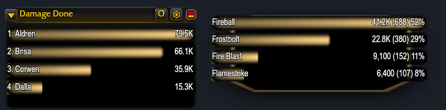
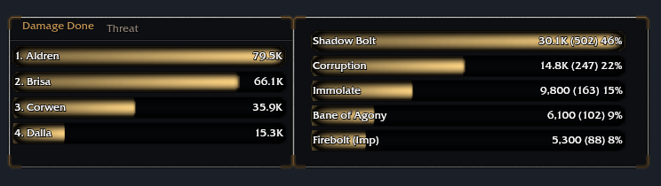

# MeterHover

Rest the mouse on a row of **WoW Forever**'s built-in damage meter and its breakdown (the
spell list a click opens) appears beside the meter. Move away and it closes. No clicking
through the meter row by row after a pull.

With [FlareUI](https://www.curseforge.com/projects/1718307)'s damage meter skin, the preview
takes the same look:

## What it does

- **Hover a row** (out of combat): after a short pause the breakdown for that player shows
  beside the meter window, laid out with your meter's own settings (bar height, text size,
  icons, class colours, style). Move to another row and it switches.
- **Move onto the preview** to scroll it or to see a spell's tooltip; it stays while the
  mouse is on it.
- **Click a row** as before: that opens Blizzard's own breakdown, Shift-click keeps it open.
  While Blizzard's breakdown is open, hovering leaves it alone.

In combat the meter's numbers are secret to addons, so the preview only works out of combat
(the damage meter shows them, MeterHover can't read them). It closes when combat starts.

## Commands

| Command | |
|---|---|
| `/meterhover` | Help, and whether the damage meter is turned on |
| `/meterhover off`, `/meterhover on` | Turn the hover preview off or on |

## Install

Copy `addons\MeterHover` into `_forever_\Interface\AddOns` and restart the game.

MeterHover works with the game's own damage meter: turn it on in **Options > Advanced >
Enable Damage Meter**. If it's off, MeterHover says so once at login and in `/meterhover`.

No other addon is needed. [FlareUI](https://www.curseforge.com/projects/1718307) is
optional; with its meter skin the preview copies its background, border and fonts.

## Limits

- Out of combat only (see above).
- Death rows (Deaths meter) open Blizzard's death recap on click; they have no hover preview.
- The preview can't be resized or moved: it sits where Blizzard's breakdown opens, with
  its width.
- Made and tested on an English client, game version 1.60.1.

## Licence

[MIT](LICENSE)
